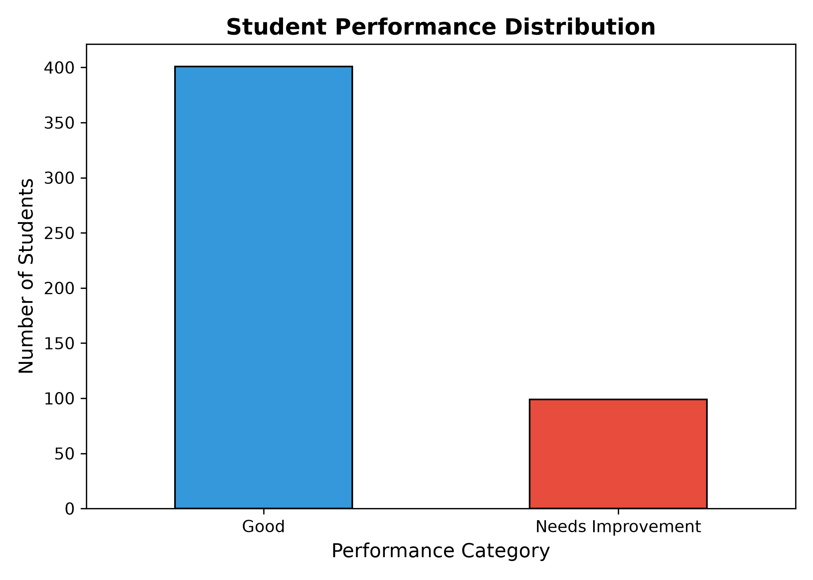
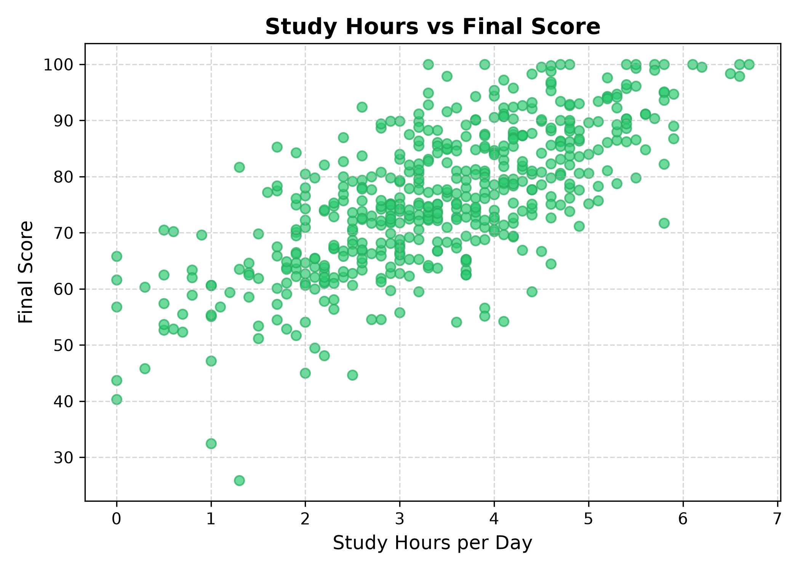
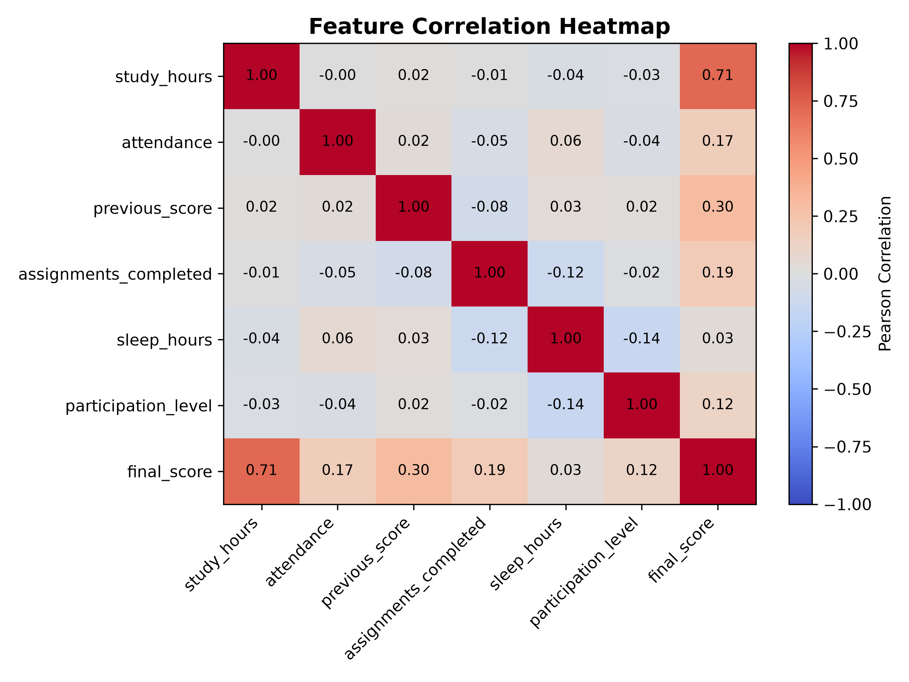

# Student Performance Analysis and Prediction Using Machine Learning


An integrated end-to-end data analysis and machine learning application developed for the **Career Shaper Centre of Excellence (CoE) Mini Project** (B.Tech Computer Science and Engineering).

---

## 👨‍🎓 Student Information

- **Name:** Aman Kumar
- **University Roll Number:** 2400320100154
- **Admission Number:** 2024B0101506
- **Branch / Section:** CSE 12

---

## 📌 Project Overview

This project explores student academic performance indicators (such as daily study hours, class attendance, previous exam scores, assignment completion, sleep hours, and classroom participation) to analyze behavior patterns and predict academic outcomes using a **Random Forest Classifier**.

### Modules Demonstrated

1. **Python Programming:** Structured execution, modular architecture, robust exception handling, and typing.
2. **OOP and Database Integration:** Object-Oriented design pattern (`StudentPerformanceProject`) coupled with a relational **SQLite** database (`student_performance.db`) for tabular storage and querying.
3. **NumPy Arrays:** Vectorized statistical operations (mean, standard deviation, min/max metrics).
4. **Pandas & Data Visualization:** Tabular data processing, inspection, missing-value validation, and visual data analytics using **Matplotlib**.
5. **Machine Learning:** End-to-end classification workflow using **Scikit-Learn** featuring stratified train/test split, Random Forest training, confusion matrix, classification report, and live sample inference.

---

## 📁 Repository Structure

```text
HCL-project-aman/
├── .gitignore                   # Standard Python gitignore rules
├── README.md                    # Project documentation & execution guide
├── requirements.txt             # Python dependencies
├── main.py                      # Application entry point
├── data/                        # Datasets and SQLite storage
│   ├── student_data.csv         # Demonstration dataset (500 records)
│   └── student_performance.db   # Generated SQLite database
├── docs/                        # Project reports and documentation
│   ├── Project_Report.docx      # Formal academic project report
│   └── Project_Synopsis.txt     # Executive summary & synopsis
├── outputs/                     # Generated visual analytics & plots
│   ├── correlation_heatmap.png
│   ├── performance_distribution.png
│   └── study_hours_vs_score.png
└── src/                         # Modular source code
    ├── __init__.py
    └── student_performance.py   # Core OOP data pipeline & ML logic
```

---

## ⚙️ Installation & Setup

### 1. Prerequisites
Ensure you have **Python 3.10+** and **Git** installed on your system.

### 2. Clone the Repository
```bash
git clone https://github.com/amank714557/HCL-project-aman.git
cd HCL-project-aman
```

### 3. Create a Virtual Environment (Recommended)
```bash
# Windows
python -m venv venv
venv\Scripts\activate

# macOS / Linux
python3 -m venv venv
source venv/bin/activate
```

### 4. Install Dependencies
```bash
pip install -r requirements.txt
```

---

## 🚀 Execution

To execute the complete end-to-end pipeline (data analysis, database sync, plot generation, model training, and sample inference), simply run:

```bash
python main.py
```

---

## 📊 Visual Analytics & Insights

The pipeline automatically saves high-resolution charts in the `outputs/` directory:

| Visualization | Description |
| :--- | :--- |
| **Performance Distribution** | Breakdown of student performance categories (`Good` vs `Needs Improvement`). |
| **Study Hours vs Score** | Scatter plot highlighting the positive correlation between study duration and final marks. |
| **Correlation Heatmap** | Comprehensive Pearson correlation matrix across all numeric behavioral features. |

### Preview:
<p align="center">
  
  
  
</p>

---

## 🤖 Machine Learning Model & Results

- **Algorithm:** Random Forest Classifier (`n_estimators=100`, `random_state=42`)
- **Evaluation Split:** 80% Training, 20% Stratified Testing
- **Accuracy:** **88.0%**

### Classification Metrics:
```text
                   precision    recall  f1-score   support

             Good       0.91      0.94      0.93        80
Needs Improvement       0.72      0.65      0.68        20

         accuracy                           0.88       100
        macro avg       0.82      0.79      0.81       100
     weighted avg       0.88      0.88      0.88       100
```

---

## ⚠️ Dataset & Academic Disclosure

> **Note:** The included `student_data.csv` contains **500 synthetic records** created specifically for instructional and demonstration purposes. It does not represent real, identifying student information.
